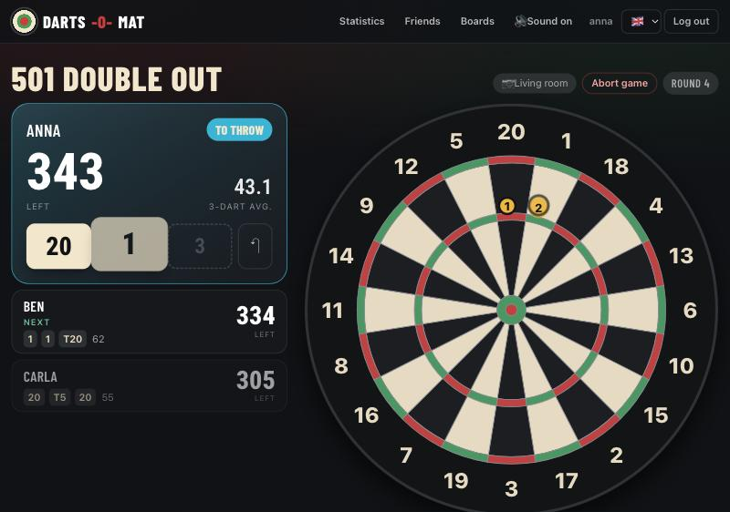
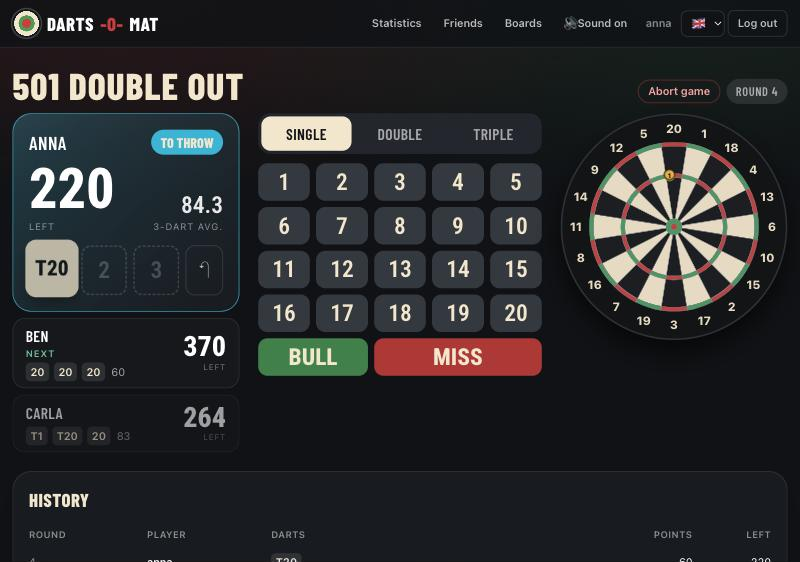
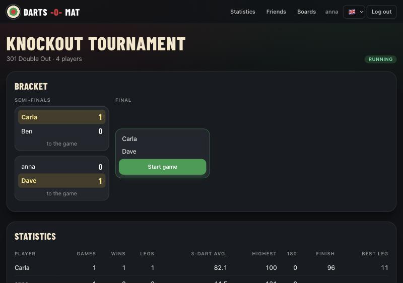
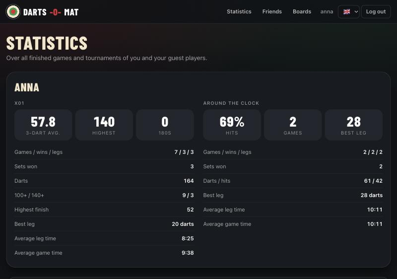
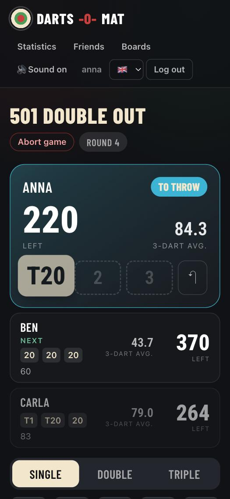

# darts-o-mat

A free, open-source darts scorer that you host yourself: enter your throws or let cameras at the board detect them, the score is counted for you. X01 and Around the Clock, legs and sets, tournaments, friends, guest players and statistics, in English and German.

> [!NOTE]
> This project was build with AI.

> **Status:** early development.

  
  

  
  

## What's in it

- **[darts-o-mat](cmd/darts-o-mat/README.md)** – the server: a web app for playing, with accounts, friends, guest players, tournaments, games with others (also with strangers) and statistics. This is all you need to play by hand.
- **[darts-o-cam](cmd/darts-o-cam/README.md)** – the camera program: runs on the computer the board's cameras are connected to, detects the darts and enters them into the running game, as an app with a window for macOS, Linux and Windows without further programs ([details on camera support](internal/cam/camera/README.md)).

## Quick start

Download the server for your system from the [latest release](https://github.com/sj14/darts-o-mat/releases/latest): [Linux](https://github.com/sj14/darts-o-mat/releases/latest/download/darts-o-mat_linux_amd64.tar.gz) ([arm64](https://github.com/sj14/darts-o-mat/releases/latest/download/darts-o-mat_linux_arm64.tar.gz)), [macOS](https://github.com/sj14/darts-o-mat/releases/latest/download/darts-o-mat_darwin_arm64.tar.gz) ([Intel](https://github.com/sj14/darts-o-mat/releases/latest/download/darts-o-mat_darwin_amd64.tar.gz)) or [Windows](https://github.com/sj14/darts-o-mat/releases/latest/download/darts-o-mat_windows_amd64.zip) ([arm64](https://github.com/sj14/darts-o-mat/releases/latest/download/darts-o-mat_windows_arm64.zip)). Unpack it, start it and open <http://localhost:3000> to create an account ("Register"). More about the server – as a container, on Kubernetes with Helm, with PostgreSQL, the options: [darts-o-mat](cmd/darts-o-mat/README.md).

darts-o-cam, for the computer the cameras are connected to, is on the same page: [macOS app](https://github.com/sj14/darts-o-mat/releases/latest/download/darts-o-cam_macos_arm64.zip) ([Intel](https://github.com/sj14/darts-o-mat/releases/latest/download/darts-o-cam_macos_amd64.zip)), [Windows](https://github.com/sj14/darts-o-mat/releases/latest/download/darts-o-cam_windows_amd64.zip) ([ARM](https://github.com/sj14/darts-o-mat/releases/latest/download/darts-o-cam_windows_arm64.zip)), Linux as [.deb](https://github.com/sj14/darts-o-mat/releases/latest/download/darts-o-cam_linux_amd64.deb) ([ARM](https://github.com/sj14/darts-o-mat/releases/latest/download/darts-o-cam_linux_arm64.deb)), [.rpm](https://github.com/sj14/darts-o-mat/releases/latest/download/darts-o-cam_linux_amd64.rpm) ([ARM](https://github.com/sj14/darts-o-mat/releases/latest/download/darts-o-cam_linux_arm64.rpm)) or [.tar.gz](https://github.com/sj14/darts-o-mat/releases/latest/download/darts-o-cam_linux_amd64.tar.gz) ([ARM](https://github.com/sj14/darts-o-mat/releases/latest/download/darts-o-cam_linux_arm64.tar.gz)). (The links without a note are for Intel/AMD processors, ARM is e.g. a Raspberry Pi; the macOS links without a note are for Apple silicon.)

## Playing with cameras

1. Start darts-o-cam on the computer the cameras are connected to, add the cameras and calibrate them once: [darts-o-cam → start](cmd/darts-o-cam/README.md#start).
2. In darts-o-mat, create your board under "Boards" and click "Create camera token".
3. Enter the server address and the token in darts-o-cam under "Settings".
4. Select this board when starting a game. The darts now appear by themselves and the keypad gives way to a large board. If a dart is missed, add it at the next free place of the visit; click a dart of yours to correct it.

On a board the next player is only up once the darts have been pulled out – the camera notices that (if it misses it, the next player's first dart counts as pulled out); without a camera, tap "Darts pulled out". If a dart of the visit is missing (e.g. bounced out), it counts as a miss.

Each player can throw at a board of their own, also when playing with friends or strangers from different places: everybody picks their board when joining.

## Community

Questions, ideas, your board setup: talk about darts-o-mat on [Reddit (r/Darts_o_Mat)](https://www.reddit.com/r/Darts_o_Mat/) or on [Lemmy (discuss.tchncs.de)](https://discuss.tchncs.de/c/Darts_o_Mat). Bugs are best reported as a [GitHub issue](https://github.com/sj14/darts-o-mat/issues).

## For developers

Notes on architecture and decisions are in the `AGENTS.md` files: [project](AGENTS.md), [server](internal/server/AGENTS.md), [camera](internal/cam/AGENTS.md), [camera access](internal/cam/camera/AGENTS.md). Run the tests with `go test ./...`. Planned work: [project](TODO.md), [server](internal/server/TODO.md), [camera](internal/cam/TODO.md), [camera access](internal/cam/camera/TODO.md).

## License

[AGPL-3.0](LICENSE), except the camera access in [`internal/cam/camera`](internal/cam/camera), which is [MIT](internal/cam/camera/LICENSE).
